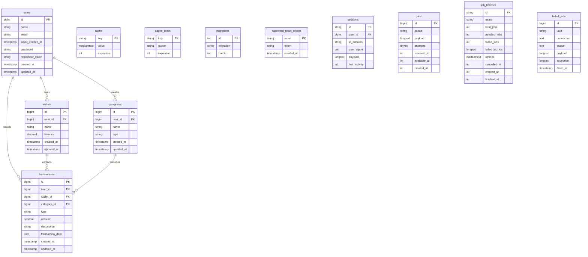

# CatatSaku — Sistem Pencatatan Keuangan Pribadi

Aplikasi web full-stack untuk membantu pengguna dalam mengelola keuangan harian, pencatatan transaksi pemasukan dan pengeluaran, manajemen dompet/rekening, klasifikasi kategori transaksi, hingga visualisasi ringkasan finansial secara real-time.

---

## 1. Informasi Proyek

| Keterangan | Detail |
| :--- | :--- |
| **Nama Aplikasi** | CatatSaku — Sistem Pencatatan Keuangan Pribadi |
| **Framework Backend** | Laravel 11 / 12 |
| **Bahasa Pemrograman** | PHP 8.2+ / 8.3 |
| **Database** | MySQL (Clever Cloud / Local MySQL) |
| **Lingkungan Pengujian Deployment** | Railway & Clever Cloud |
| **Antarmuka (Frontend)** | Laravel Blade, Tailwind CSS, Vite |
| **Arsitektur Sistem** | Model-View-Controller (MVC) |

---

## 2. Fitur Aplikasi

### Autentikasi dan Manajemen Sesi
- Registrasi akun pengguna baru.
- Login dan logout pengguna.
- Pembaruan dan enkripsi sesi autentikasi.
- Pembatasan rute privat menggunakan middleware `auth`.
- Halaman internal (Dashboard, Dompet, Transaksi, Kategori) hanya dapat diakses setelah login.

### Dashboard Finansial
- Menampilkan total saldo gabungan seluruh dompet.
- Menampilkan total pemasukan kumulatif.
- Menampilkan total pengeluaran kumulatif.
- Menampilkan ringkasan statistik mutasi keuangan terkini.
- Menampilkan 5 riwayat transaksi terakhir.

### Manajemen Dompet / Rekening (Wallets)
- Melihat daftar dompet (misal: Rekening Bank, Dompet Digital, Uang Tunai).
- Menambahkan dompet baru beserta saldo awal.
- Mengubah nama dompet dan saldo.
- Menghapus dompet (disertai otomatisasi penghapusan transaksi terkait via *cascade*).

### Manajemen Kategori Transaksi (Categories)
- Melihat daftar kategori transaksi.
- Menambahkan kategori transaksi baru (pemasukan/pengeluaran).
- Mengubah nama dan tipe kategori.
- Menghapus kategori yang sudah tidak digunakan.

### Pencatatan Transaksi (Transactions)
- Mencatat transaksi pemasukan (*income*).
- Mencatat transaksi pengeluaran (*expense*).
- Memperbarui akumulasi saldo dompet secara otomatis sesuai jenis transaksi.
- Menolak/memvalidasi transaksi jika input nominal tidak valid.
- Menyimpan detail tanggal transaksi, nominal, kategori, dompet, dan deskripsi.
- Filter dan pencarian riwayat transaksi berdasarkan dompet atau jenis transaksi.

---

## 3. Role Pengguna

| Role | Hak Akses |
| :--- | :--- |
| **User (Pemilik Akun)** | Memiliki akses penuh terhadap seluruh fitur aplikasi pribadi (Dashboard, Manajemen Dompet, Kategori, Transaksi, dan Pengaturan Profil). Data terisolasi penuh per pengguna berdasarkan `user_id`. |

Pembatasan akses antar pengguna diimplementasikan menggunakan pemfilteran kueri berbasis ID pengguna yang sedang login (`Auth::id()`) serta middleware `auth` pada rute aplikasi.

---

## 4. Akun Tester / Demo

Gunakan akun berikut untuk melakukan pengujian langsung pada server live deployment maupun basis data lokal yang telah di-seed:

| Email | Password | Keterangan |
| :--- | :--- | :--- |
| `dosen.demo@cakrawala` | `Demodosen2026` | Akun Demo Uji Coba Penguji |

---

## 5. Persyaratan Sistem

Sebelum menjalankan aplikasi di komputer lokal, pastikan prasyarat software berikut telah terpasang:

- PHP 8.2 atau versi yang lebih tinggi.
- Composer (PHP Dependency Manager).
- MySQL Server (via XAMPP, Laragon, atau MySQL Standalone).
- Node.js & NPM (untuk kompilasi aset frontend).
- Git.
- Web Browser (Chrome, Firefox, Edge).

Pastikan ekstensi PHP yang dibutuhkan Laravel seperti `pdo_mysql`, `mbstring`, `openssl`, dan `bcmath` sudah dalam keadaan aktif.

---

## 6. Instalasi dan Menjalankan Aplikasi di Komputer Lokal

### Langkah 1 — Kloning Repositori
```bash
git clone https://github.com/aryariza/catatsaku-financial-tracker.git
cd catatsaku-financial-tracker
```

### Langkah 2 — Instal Dependensi PHP dan Frontend
```bash
composer install
npm install
```

### Langkah 3 — Buat Database MySQL
1. Buka MySQL Client (phpMyAdmin, TablePlus, atau MySQL CLI).
2. Buat database baru dengan nama `catatsaku_db`.

### Langkah 4 — Konfigurasi File Environment
Salin `.env.example` menjadi `.env`:

- **Windows PowerShell:**
  ```powershell
  Copy-Item .env.example .env
  ```
- **Linux / MacOS / CMD:**
  ```bash
  cp .env.example .env
  ```

Buka file `.env` dan sesuaikan pengaturan koneksi database:
```env
APP_NAME="CatatSaku"
APP_ENV=local
APP_KEY=
APP_DEBUG=true
APP_URL=http://127.0.0.1:8000

DB_CONNECTION=mysql
DB_HOST=127.0.0.1
DB_PORT=3306
DB_DATABASE=catatsaku_db
DB_USERNAME=root
DB_PASSWORD=
```

### Langkah 5 — Generate Application Key
```bash
php artisan key:generate
```

### Langkah 6 — Menjalankan Migrasi dan Seeder
```bash
php artisan migrate --seed
```

Perintah di atas akan membentuk tabel-tabel utama berikut:
- `users`
- `wallets`
- `categories`
- `transactions`
- Tabel infrastruktur Laravel (`cache`, `sessions`, `jobs`, `migrations`, `failed_jobs`, dll).

### Langkah 7 — Build Aset Frontend
```bash
npm run build
```

Untuk mode pengembangan frontend secara interaktif:
```bash
npm run dev
```

### Langkah 8 — Jalankan Server Aplikasi
```bash
php artisan serve
```
Akses aplikasi melalui peramban web di alamat: `http://127.0.0.1:8000`

---

## 7. Struktur Direktori Utama

```text
catatsaku-financial-tracker/
├── app/
│   ├── Http/
│   │   ├── Controllers/
│   │   │   ├── AuthController.php
│   │   │   ├── CategoryController.php
│   │   │   ├── DashboardController.php
│   │   │   ├── TransactionController.php
│   │   │   └── WalletController.php
│   │   └── Middleware/
│   └── Models/
│       ├── Category.php
│       ├── Transaction.php
│       ├── User.php
│       └── Wallet.php
├── bootstrap/
├── database/
│   ├── migrations/
│   └── seeders/
├── public/
├── resources/
│   └── views/
│       ├── auth/
│       ├── categories/
│       ├── dashboard.blade.php
│       ├── layouts/
│       ├── transactions/
│       └── wallets/
├── routes/
│   └── web.php
├── .env.example
├── artisan
├── composer.json
└── package.json
```

---

## 8. Gambaran Database

### 8.1 Entity Relationship Diagram (ERD)

Berikut adalah diagram relasi antartabel pada sistem **CatatSaku** yang dibangun menggunakan sintaks Mermaid:



---

### 8.2 Penjelasan Relasi Entitas Utama

| Relasi | Kardinalitas | Penjelasan |
| :--- | :--- | :--- |
| `users` -> `wallets` | One-to-Many (1:N) | Satu pengguna dapat memiliki banyak dompet/rekening. Setiap dompet terikat ke pengguna via `user_id`. |
| `users` -> `categories` | One-to-Many (1:N) | Satu pengguna dapat membuat banyak kategori kustom. Setiap kategori terikat via `user_id`. |
| `users` -> `transactions` | One-to-Many (1:N) | Satu pengguna dapat mencatat banyak transaksi. Setiap transaksi terikat via `user_id`. |
| `wallets` -> `transactions` | One-to-Many (1:N) | Satu dompet dapat memiliki banyak catatan transaksi. Terikat via `wallet_id`. |
| `categories` -> `transactions` | One-to-Many (1:N) | Satu kategori dapat digunakan di banyak transaksi. Terikat via `category_id`. |

---

### 8.3 Keterangan Kunci Utama (PK) dan Kunci Tamu (FK)

| Tabel | Primary Key | Foreign Key |
| :--- | :--- | :--- |
| `users` | `id` | - |
| `wallets` | `id` | `user_id` -> `users.id` |
| `categories` | `id` | `user_id` -> `users.id` |
| `transactions` | `id` | `user_id` -> `users.id`<br>`wallet_id` -> `wallets.id`<br>`category_id` -> `categories.id` |

---

### 8.4 Alur Data Transaksi
1. Pengguna membuat dompet (contoh: *Bank BCA*) dan saldo awal dimasukkan.
2. Pengguna membuat kategori transaksi (contoh: *Gaji* untuk Pemasukan, *Makanan* untuk Pengeluaran).
3. Pengguna menginput transaksi baru (pemasukan/pengeluaran) dengan memilih dompet dan kategori.
4. Controller memproses data, menyimpan entri ke tabel `transactions`, dan memperbarui nilai `balance` pada tabel `wallets` secara otomatis dalam *Database Transaction*.
5. Dashboard memperbarui statistik total saldo, total pemasukan, dan pengeluaran secara terintegrasi.

---

## 9. Daftar Rute / Halaman Utama

| Halaman | Metod HTTP | URL Route | Proteksi Access |
| :--- | :--- | :--- | :--- |
| Login | GET / POST | `/login` | Guest |
| Register | GET / POST | `/register` | Guest |
| Logout | POST | `/logout` | Auth |
| Dashboard | GET | `/dashboard` | Auth |
| Daftar Dompet | GET | `/wallets` | Auth |
| Tambah Dompet | POST | `/wallets` | Auth |
| Daftar Kategori | GET | `/categories` | Auth |
| Tambah Kategori | POST | `/categories` | Auth |
| Daftar Transaksi | GET | `/transactions` | Auth |
| Tambah Transaksi | GET / POST | `/transactions/create` | Auth |
| Hapus Transaksi | DELETE | `/transactions/{id}` | Auth |

---

## 10. Pengujian Manual (Skenario Pengujian)

1. Buka URL `/register` dan buat akun pengguna baru.
2. Buka URL `/login` dan masuk menggunakan akun demo (`dosen.demo@cakrawala`).
3. Akses menu **Dompet**, lalu tambahkan dompet baru (*misal: Dompet Digital - Saldo Rp 500.000*).
4. Akses menu **Kategori**, tambahkan kategori pengeluaran (*misal: Transportasi*).
5. Tambahkan transaksi pengeluaran baru sebesar Rp 50.000 menggunakan dompet dan kategori yang telah dibuat.
6. Periksa saldo dompet pada menu **Dompet** (saldo harus berkurang menjadi Rp 450.000).
7. Periksa statistik pada **Dashboard** untuk memastikan grafik dan total akumulasi diperbarui secara tepat.
8. Coba lakukan akses langsung ke `/dashboard` melalui mode incognito tanpa login untuk memastikan sistem mengalihkan ke `/login`.

---

## 11. Keamanan dan Catatan Pengembangan

- Kerentanan **SQL Injection** dicegah penuh dengan menggunakan PDO Parameter Binding melalui Eloquent ORM.
- **Cross-Site Scripting (XSS)** dicegah melalui sanitasi tampilan bawaan Blade Templating (`{{ $variable }}`).
- Seluruh form input dilengkapi dengan token `@csrf` untuk mencegah **Cross-Site Request Forgery**.
- Kredensial sensitif diisolasi penuh dalam file `.env` dan diabaikan dari repositori melalui file `.gitignore`.
- Password pengguna dienkripsi menggunakan algoritma hashing standar `Bcrypt`.

---

## 12. Perintah Artisan yang Berguna

```bash
# Melihat daftar seluruh rute
php artisan route:list

# Menjalankan ulang migrasi dari awal beserta data seeder
php artisan migrate:fresh --seed

# Menghapus seluruh cache aplikasi
php artisan optimize:clear

# Menjalankan shell interaktif Laravel Tinker
php artisan tinker
```

---

## 13. Pengembang

- **Nama Mahasiswa:** Arya Riza Pratama
- **NIM:** 25110300031
- **Mata Kuliah:** Web Application Development (UAS)
- **Institusi:** Universitas Cakrawala